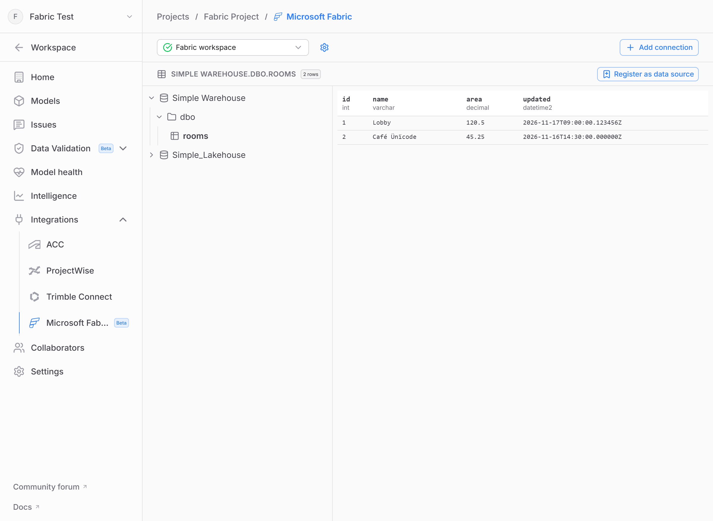
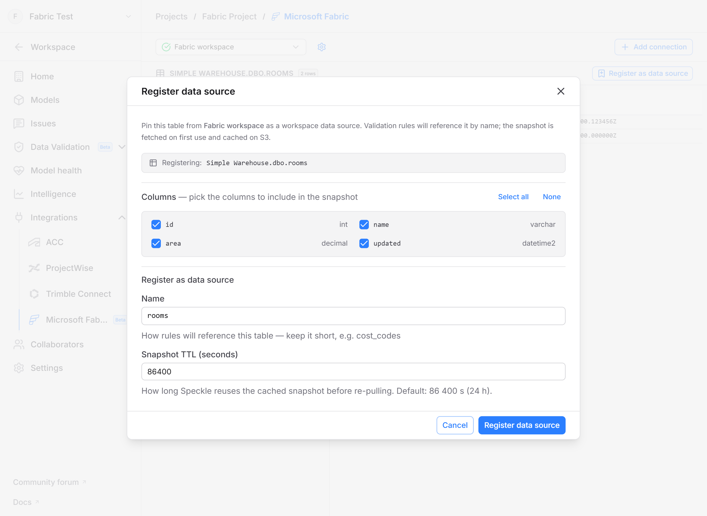

<Badge>Beta</Badge>

<Note>
  The Microsoft Fabric integration is in **Beta** and is enabled per workspace. Before you can
  register tables or views, an IT administrator must prepare Microsoft Fabric and connect a
  Warehouse or Lakehouse in Speckle. If your project's **Integrations** does not show Microsoft
  Fabric, ask your IT administrator to follow [Enable Microsoft Fabric
  integration](/it-admin/integrations/microsoft-fabric).
</Note>

Speckle reads tables and views from a Fabric **Warehouse** or from a **Lakehouse** through its SQL analytics endpoint. It never writes to Fabric.

## Setup

These steps assume an IT administrator has already connected a Fabric Warehouse or Lakehouse in Speckle. If it hasn't, your IT administrator must complete [Enable Microsoft Fabric integration](/it-admin/integrations/microsoft-fabric) first. Browsing and registering tables is for workspace admins.

<Steps>
  <Step title="Browse to your table or view">
    In Speckle, open your project's **Integrations \> Microsoft Fabric**. If your workspace has several connections, pick one from the list at the top of the page. Expand a Warehouse or Lakehouse, then a **schema**, and select a table or view to preview its rows. A connection limited to one Warehouse or Lakehouse starts at its schemas.

    <Frame>
      
    </Frame>

    Only the Warehouses and Lakehouses the connection can read appear. You can preview the rows before registering.

  </Step>
  <Step title="Choose the columns and register">
    Select **Register as data source**, pick the **columns** to include — only the columns you choose are ever read or cached — then choose a short **Name** for the data source. Use letters, numbers, and underscores, starting with a letter or an underscore. You can also adjust the **Snapshot TTL** (time to live) if the default freshness window does not fit your workflow. The TTL controls how long Speckle reuses the cached snapshot before it is considered stale. Select **Register data source** to finish.

    <Frame>
      
    </Frame>

    The table or view is marked as registered and appears as a data source in your workspace.

  </Step>
</Steps>

Registered data sources are available to Speckle tools such as the **AI chat**, where you can query the table and combine it with your model data. See [Intelligence Dashboards](/analytics/intelligence-dashboards) for analytics and data tools.

## How snapshots are stored and refreshed

When you register a table or view, Speckle reads the columns you selected and stores a cached **snapshot** in your workspace's object storage. Tools query the snapshot rather than your live Warehouse or Lakehouse.

- **Snapshot TTL.** TTL means **time to live**. It is the freshness window for the cached snapshot. The default is 24 hours.
- **Automatic refresh.** After the TTL expires, the snapshot is marked stale. Speckle rebuilds it from Fabric the next time a tool uses that registered data source. If a refresh fails, Speckle keeps the last snapshot and doesn't try again automatically for 15 minutes.
- **Manual refresh.** Select the registered table and then **Refresh now** to force an immediate refresh, for example right after the source data changes. A manual refresh runs even during those 15 minutes.
- **Disconnecting.** If your IT administrator disconnects the Fabric connection, registered sources keep serving their **last snapshot read-only**. Reconnecting the connection resumes refreshing.

## FAQ

<AccordionGroup>
  <Accordion title="Can Speckle modify or write to my Warehouse or Lakehouse?">
    No. The integration is **read-only** — Speckle issues read-only queries only and never writes,
    updates, or deletes data in Microsoft Fabric.
  </Accordion>
  <Accordion title="Why is a new Lakehouse table missing from the list?">
    Speckle reads a Lakehouse through its SQL analytics endpoint, and a new table can take a short
    while to appear there. Wait a moment and reload the page. If nothing at all is listed, ask your
    IT administrator to check the connection. See
    [Troubleshooting](/it-admin/integrations/microsoft-fabric#troubleshooting).
  </Accordion>
  <Accordion title="Why can I not open or register a table?">
    Speckle reads schemas, tables, and columns whose names start with a letter or an underscore and
    contain only letters, numbers, spaces, and the characters `_`, `$`, `#`, and `@`. A table, or a
    selected column, with any other character in its name cannot be registered. Create a view in
    Fabric with names that fit, and register the view.
  </Accordion>
  <Accordion title="Why does a manual refresh say a refresh is already running?">
    Another refresh of the same data source started first. Speckle waits up to 60 seconds for it to
    finish, then asks you to try again once it is done.
  </Accordion>
</AccordionGroup>
