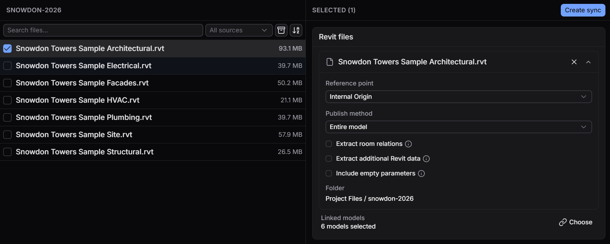
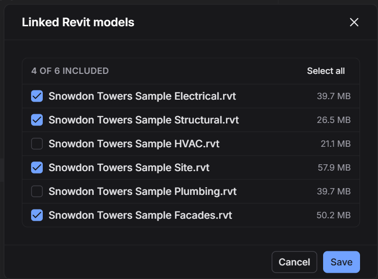
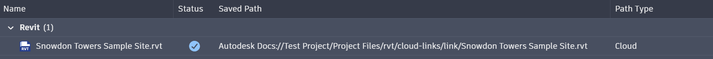
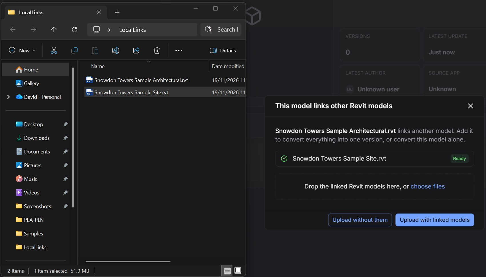
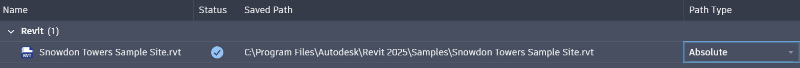
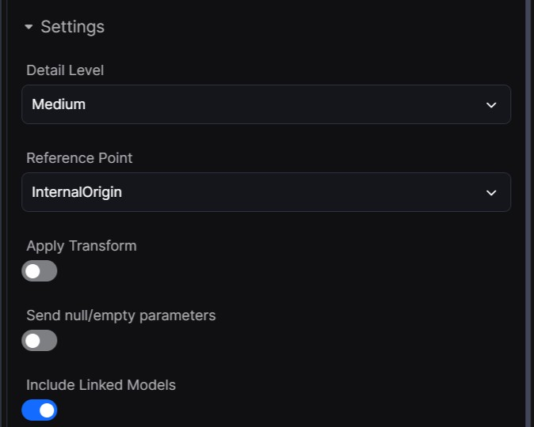
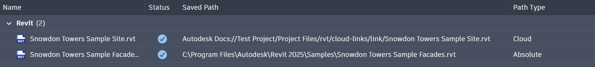

A Revit model often links other Revit models, such as a site, a structure or MEP disciplines.
Speckle can bring the host model in together with its linked models, as **one version of the host's
model** with every link placed as it is in Revit.

## Three ways to bring in linked models

### 1. Sync from Forma Data Management

Select the host Revit file on the ACC page and create a sync. **Linked models** under the file shows
how many of its links the sync converts. Select **Choose** to leave some out.

<Frame caption="Linked models under the selected Revit file.">
  
</Frame>

<Frame caption="Uncheck the links to leave out.">
  
</Frame>

**Links it takes:** the sync is designed for **cloud model links**, which point at cloud models in
Autodesk Docs. When Forma Data Management has recorded no links for the host, Speckle also reads
the **local links** from the host file and looks for files with the same names in the project.

<Frame caption="A cloud model link in Manage Links: the Saved Path starts with Autodesk Docs://.">
  
</Frame>

See [Sync a Revit file with its linked models](#sync-a-revit-file-with-its-linked-models).

### 2. Upload with drag and drop

Drop the host `.rvt` and its linked `.rvt` files on a model together. If you drop only the host,
Speckle lists the links it needs, and you can add them in the same dialog.

<Frame caption="The linked model dropped together with the host is Ready.">
  
</Frame>

**Links it takes:** mainly **local links**, the linked files you have on your computer or network.
For a cloud model you downloaded, the dialog also asks for its cloud model links.

<Frame caption="A local link in Manage Links: the Saved Path is a drive path.">
  
</Frame>

See [Upload a Revit model with its linked models](#upload-a-revit-model-with-its-linked-models).

### 3. Publish from the Revit connector

In Revit, open the host model. In the Speckle publish card, expand **Settings**, check that
**Include Linked Models** is on, and publish.

<Frame caption="Include Linked Models in the publish settings.">
  
</Frame>

**Links it takes:** both **cloud model links** and **local links**, even in the same host. Revit has
already opened every loaded link, so the connector converts them on your computer.

<Frame caption="A host with a cloud model link and a local link. The connector publishes both.">
  
</Frame>

See [Publish linked models from the Revit connector](#publish-linked-models-from-the-revit-connector).

<Note>
  Syncs and uploads convert Revit (`.rvt`) links only, up to 100 per version. Linked DWG, IFC, point
  cloud and PDF files are left out.
</Note>

## Sync a Revit file with its linked models

<Note>
  On self-hosted deployments, Forma Data Management syncs require Speckle Enterprise Server and a
  [license key](/developers/server/deployment/enterprise-license#license-key). See [ACC
  integration](/developers/server/deployment/enterprise-license#optional-acc-integration).
</Note>

Sync only the host Revit file. Each time the sync runs, Speckle finds the models the host links,
downloads them from Forma Data Management and converts them with the host. You don't create syncs
for the linked files.

### Choose which linked models to convert

Under each Revit file on the ACC page, and in an existing sync's settings, **Linked models** shows
how many links the sync converts, such as **6 models selected**. By default, every link is selected.

Select **Choose** to open **Linked Revit models**. It lists the links the next run would find, all
checked by default. Uncheck a link to leave it out, or select **Deselect all** to convert the host
alone. Then select **Save**.

- **Links added later**: a link added to the host after you chose is converted, unless you
  deselected all links.
- **Over the limit**: the dialog warns when more links are checked than one conversion takes.
- **Existing syncs**: to choose for an existing sync, open its settings from the ACC page.

### Which version of a link is converted

- A link Forma Data Management records for the host converts at the version recorded with the host.
- A link Speckle finds by reading the host file converts at its **latest** version.
- A new version of a linked model does not run the host's sync. The next host version picks it up,
  or select **Trigger now** on the host's sync to bring it in sooner.

A link that cannot be fetched does not fail the sync: the host converts with the links that remain.
To see which links a version includes, open the version in the viewer and check **Linked files** on
the [Health](/3d-viewer/exploration#model-health) panel.

## Upload a Revit model with its linked models

When you drop a Revit file on a project, Speckle reads which Revit models it links before anything
is uploaded. If you dropped the linked files together with the host, the upload starts straight
away. Otherwise **This model links other Revit models** opens and lists each link as **Ready** or
**Missing**.

<Steps>
  <Step title="Add the missing linked models">
    Drop the linked `.rvt` files on the dialog. Each row you supply turns **Ready**.
  </Step>
  <Step title="Start the upload">
    Select **Upload with linked models**. The host and the supplied links convert into one version.
  </Step>
</Steps>

- **Matching**: a file is matched to a link by its file name. Letter case doesn't matter, other
  characters must match exactly. A dropped file the host doesn't link is left out.
- **Unloaded links** aren't asked for: only the links Revit had loaded when the file was saved.
- **Models saved to Autodesk Docs**: for a cloud model you downloaded, the dialog also asks for its
  cloud model links. Speckle reads the whole file in the browser to find them, which can take a few
  seconds for a large model.

To convert the host alone, select **Upload without them**. Closing the dialog with **X**, **Esc** or
a click outside asks first: go back, cancel the upload, or upload without the linked models.

## Publish linked models from the Revit connector

The Revit connector converts the links Revit has loaded in the open host model. You can use both
cloud model links and local links, even in the same host: Revit has already opened them, so the
connector doesn't need to find them anywhere.

<Steps>
  <Step title="Load the links in Revit">
    Open the host and check in **Manage Links** that each link you want is **Loaded**. Unloaded
    links are left out.
  </Step>
  <Step title="Turn on Include Linked Models">
    In the publish card, expand **Settings** and turn on **Include Linked Models**. It's on by
    default.
  </Step>
  <Step title="Publish">Choose the objects to publish and select **Publish**.</Step>
</Steps>

- **What's included from a link** follows the publish filter: by **Categories**, the link's
  elements in those categories; by **Views**, the link's elements visible in the view; by
  **Selection**, the whole link when you select it. In Revit 2023 and earlier, a view publishes the
  whole link if it is visible in that view.
- **In Speckle**, each linked model gets its own collection, named after the linked file, next to
  the host's. A file linked more than once gets numbered collections, such as `Site_1` and
  `Site_2`.
- **Read only**: linked elements can't be edited from Speckle, for example in the parameter editor.
- **With the setting off**, the links are left out and the publish report lists a warning for each
  one.
