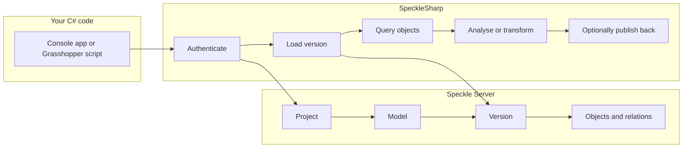

When you automate AEC workflows from C#, your code uses **SpeckleSharp** to talk to **Speckle Server**. Speckle Server stores **projects**, **models**, and **versions**. Each version holds the model's **objects**, their properties, and the **relations** between them — structured model data instead of files.

**When to read this:** before deep dives into guides or API reference. **Read next:** [Build your first model analysis tool](/developers/sdks/dotnet/guides/build-your-first-model-analysis-tool) for a complete script, or [Load and publish model data](/developers/sdks/dotnet/concepts/send-and-receive-paths) to pick a load or publish method.

## The mental model

```text
Your C# code  ──SpeckleSharp──►  Speckle Server
                                      │
                    ┌─────────────────┼─────────────────┐
                    ▼                 ▼                 ▼
               Workspace          Project            Model
                    │                 │                 │
                    │                 └────► Version ◄──┘
                    │                        │
                    │                        ▼
                    │              Objects + relations
                    │              (walls, doors, rooms, meshes…)
                    ▼
```



## The recommended workflow

Most AEC automation scripts follow these steps:

1. **Authenticate** — personal access token from an environment variable (recommended for scripts)
2. **Choose a project and model** — IDs from the Speckle web app URL
3. **Load a version** — usually the latest published version on that model
4. **Query objects** — `model.Objects`, `ObjectsWith`, and relation accessors such as `Level` and `Host` on the `Model` that `Receive3` returns
5. **Analyse or transform data** — counts, QA checks, CSV export, custom logic
6. **Optionally publish results back** — `Send3` with a `BundleBuilder` when you want a new version

<Tip>
  The recommended approach for most AEC automation scripts: PAT via env var → `Receive3` latest
  version → query `model.Objects` → analyse → optional `Send3`.
</Tip>

## Platform concepts

Speckle organizes data as **projects → models → versions**, not files. The GraphQL API exposes projects, models, and versions; `IOperations` loads and publishes the data inside a version. How that data is shaped: [Object model](/developers/object-model/overview).

`IClient` exposes each level as a typed resource:

```csharp Example lines icon="/images/developers/sdks/csharp.svg"
var project = await client.Project.Create(new ProjectCreateInput("Office Renovation", null, ProjectVisibility.Private));
var model = await client.Model.Create(new CreateModelInput("Structural Model", null, project.id));
var versions = await client.Version.GetVersions(model.id, project.id, limit: 1);
```

<Info>
  Some lower-level APIs (transports, `Send`/`Receive`) still use `streamId` for what the GraphQL API
  calls `projectId`. Pass your project's `id` — they are the same value.
</Info>

Object modeling for versions published before 2026.9 (`Base`, `DataObject`, `Collection`, detachment, `displayValue`): [Work with model objects](/developers/sdks/dotnet/concepts/objects-and-traversal).

## Load and publish model data

`IOperations` loads and publishes model data. For scripts and notebooks, **`Receive3`** loads a version and **`Send3`** publishes one. See [Load and publish model data](/developers/sdks/dotnet/concepts/send-and-receive-paths) for every entry point.

```csharp Example lines icon="/images/developers/sdks/csharp.svg"
using var received = await operations.Receive3(account, project.id, model.id, versionId, options: null, cancellationToken: default);
var byLevel = received.Objects.GroupBy(o => o.Level?.Name ?? "Unknown");
```

## Object graphs before 2026.9

<Note>
  The sections below apply to the object-graph path (`Send`, `Send2`, `Receive2`) used by versions
  published before 2026.9. A 2026.9 version identifies objects by `applicationId` only. See [Object
  model](/developers/object-model/overview).
</Note>

### Object IDs (hashes)

Every sent object has a unique **object ID**, deterministically generated from its content.

<Warning>
  `Base.GetId()` is obsolete and does not match the IDs produced by every send path. Always use the
  ID returned by the send operation you actually called (`Operations.Send`, `Send2`, or
  `SendPipeline`) rather than computing it separately.
</Warning>

### Transports

The classic `Send`/`Receive` + `ServerTransport` pair moves object graphs through a transport:

```csharp Example lines icon="/images/developers/sdks/csharp.svg"
using var transport = provider.GetRequiredService<IServerTransportFactory>().Create(client.Account, project.id);

var (objectId, _) = await operations.Send(myData, transport, useDefaultCache: true);
var received = await operations.Receive(objectId, remoteTransport: transport);
```

### Orphaned objects

<Warning>
  Objects sent to the server but not referenced by any version are **orphaned** — stored with an
  object ID but unreachable through the Speckle UI until a version references them.
</Warning>

```csharp Example lines icon="/images/developers/sdks/csharp.svg"
var (objectId, _) = await operations.Send(myData, transport, true);
// Without creating a version, this object is orphaned

var version = await client.Version.Create(new CreateVersionInput(objectId, model.id, project.id, "My data"));
```

Always create a version after sending data you want users to find.

### The type system

Every object carries a `speckle_type`, derived from its .NET type, which lets `Receive` reconstruct the correct concrete type:

```csharp Example lines icon="/images/developers/sdks/csharp.svg"
using Speckle.Objects.Geometry;
using Speckle.Sdk.Common;

var point = new Point(1, 2, 3, Units.Meters);
Console.WriteLine(point.speckle_type); // "Objects.Geometry.Point"
```

<Info>
  Custom types and traversal: [Work with model
  objects](/developers/sdks/dotnet/concepts/objects-and-traversal). Geometry types: [Working with
  Geometry](/developers/sdks/dotnet/guides/working-with-geometry).
</Info>

### Local cache

Speckle.Sdk maintains a local SQLite cache under the current user's application data folder (`.../Speckle/`), used automatically by `Send`/`Receive` when `useDefaultCache: true`.

## FAQ

<AccordionGroup>
  <Accordion title="What happens if I send data but never create a version?">
    With `Send` or `Send2`, the object is stored on the server with an object ID, but it is
    **orphaned** until a version references it. `Send3` creates the version for you when the server
    finishes processing the upload.
  </Accordion>
  <Accordion title="Should I use Send, Send2, or Send3?">
    Use **`Send3`** to publish and **`Receive3`** to load. `Send`, `Send2`, and the old receive
    calls are obsolete, and Speckle does not guarantee them for new work; keep `Receive2` or a
    transport `Receive` only to read versions published before 2026.9. See [Load and publish model
    data](/developers/sdks/dotnet/concepts/send-and-receive-paths).
  </Accordion>
  <Accordion title="Why does streamId appear in transport code?">
    Older transport APIs use `streamId` for what the GraphQL API calls `projectId`. Pass your
    project's `id` — they are the same value.
  </Accordion>
</AccordionGroup>

## Next Steps

<CardGroup cols={3}>
  <Card
    title="Build your first model analysis tool"
    icon="chart-bar"
    href="/developers/sdks/dotnet/guides/build-your-first-model-analysis-tool"
  >
    Load, query, and export a CSV report
  </Card>
  <Card
    title="Load and publish model data"
    icon="route"
    href="/developers/sdks/dotnet/concepts/send-and-receive-paths"
  >
    Choose Receive3, Send3, or SendPipeline
  </Card>
  <Card title="Operations API" icon="code" href="/developers/sdks/dotnet/api-reference/operations">
    Receive3 and Send3 signatures
  </Card>
</CardGroup>
