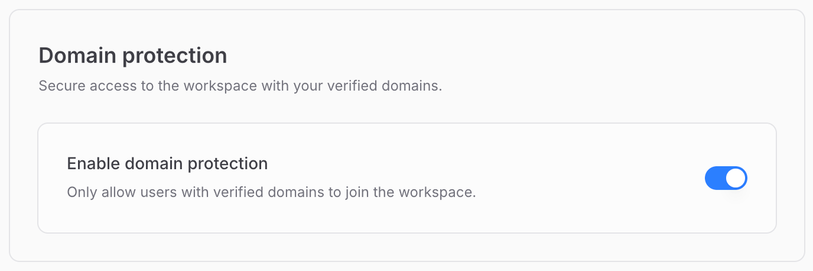
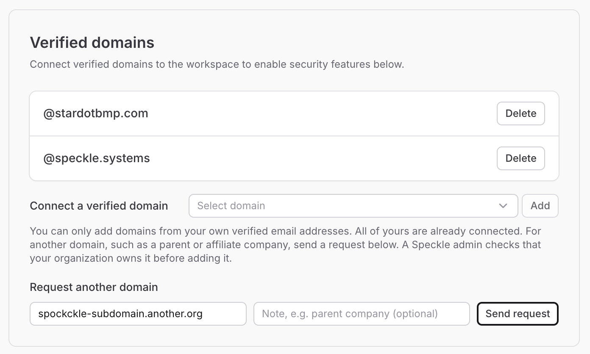

<Note>Domain protection is available on paid plans.</Note>

Domain protection lets you control who can access your workspace by limiting it to users with specific email domains.

## Enable domain protection

Admins can enable domain protection under Settings -> Security.
Workspace members can see this section, but only workspace admins can change these controls.
In Settings -> Security, this control appears in the **Domain protection** section.

<Frame>
  
</Frame>

<Steps>
  <Step title="Connect verified domains to workspace">
    Domain protection works by connecting one or more verified domains to the workspace. Add these from the top of the Security settings page.

    The email domain you used when signing up to Speckle will already be verified, so you can add it as a verified domain to your workspace with a single click (unless you signed up with Gmail, Outlook, or another public email provider).

    To connect another domain you already have a verified email on, verify that email in your [email settings](https://app.speckle.systems/settings/user/emails) (avatar menu -> User settings -> Emails). It then appears in the domain list on this page.

    For a domain you have no verified email on, such as a parent or affiliate company, [request the domain](#request-a-domain-you-cannot-verify). Sending a request does not connect the domain.

  </Step>
  <Step title="Enable domain protection">
    Enable domain protection with the toggle switch on the Security settings page.
    </Step>
</Steps>

<Info>
  If your organization uses the [SSO](/workspaces/sso) feature, you don't need to also enable domain
  protection.
</Info>

### When domain protection is enabled

1. Admins cannot invite new members whose email isn't from the verified domains list.
2. Users with the Guest role can still join the workspace even if their email doesn't match any verified domains, since this role is designed for external collaborators.

## Request a domain you cannot verify

Use this when the domain belongs to your organization, but none of your verified emails are on it. A parent company or an affiliate is a typical case.

The request records the domain and an optional note. It does not connect the domain to the workspace. On Speckle cloud, a Speckle admin checks that your organization owns the domain and then adds it. On a self-hosted server, your server administrator does that. You are not notified of the decision. The domain appears under **Verified domains** after it is added.

<Frame>
  
</Frame>

<Steps>
  <Step title="Open Security settings">
    Open the workspace, then go to Settings -> Security. The **Verified domains** card is at the top of the page.
  </Step>
  <Step title="Enter the domain">
    Under **Request another domain**, enter the domain, such as `example.com`. Add a note when it explains how your organization relates to that domain. The note can be up to 500 characters.
  </Step>
  <Step title="Send the request">
    Select **Send request**. You should see a confirmation that the request was sent. The domain is not connected until it is added.
  </Step>
</Steps>

<Note>
  On a self-hosted server, the request goes to your server administrator. [Choose where those
  requests are sent](/developers/server/configuration/environment-variables#email).
</Note>

## FAQ

<AccordionGroup>
  <Accordion title="What happens if I request a public email domain?">
    Public email providers, such as Gmail or Outlook, cannot be requested or connected.
  </Accordion>
  <Accordion title="What happens if the domain is already connected?">
    The request is rejected. The domain is already on the workspace.
  </Accordion>
  <Accordion title="What happens if I send the same request again?">
    While a request for that domain is still waiting, another send does not create a new request or
    send another notice. A waiting request expires after 7 days. You can send it again after that.
  </Accordion>
  <Accordion title="How many requests can I send?">
    You can send 5 requests for one workspace in a day, and 10 requests per person in a day across
    workspaces.
  </Accordion>
</AccordionGroup>
