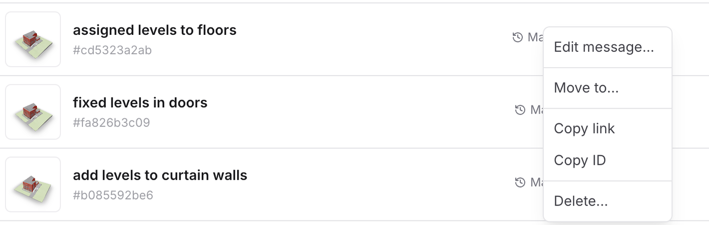
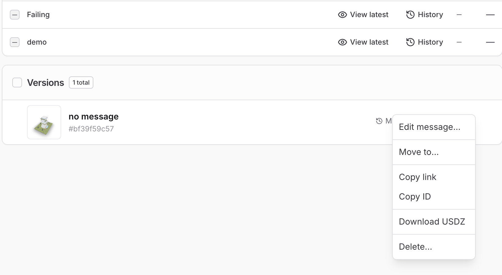
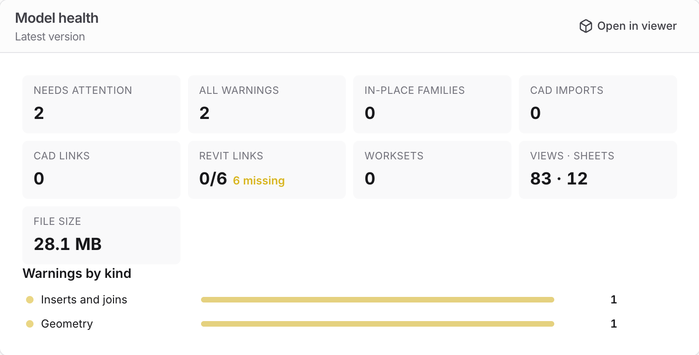
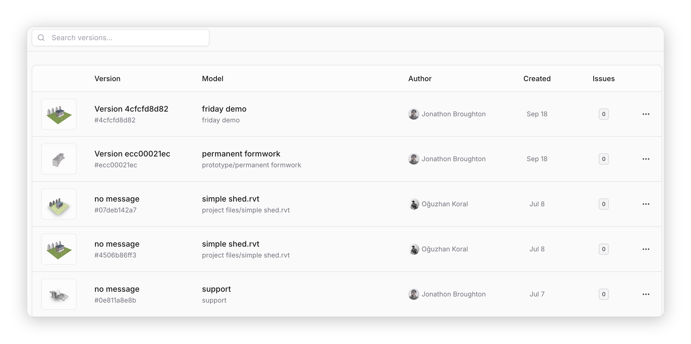
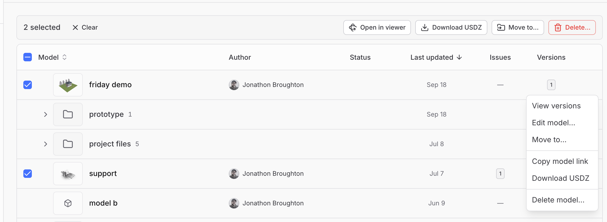

Every time new data is published to a **model**, a new **version** is created.
This is a snapshot of your model at a specific point in time, a moment in your project's history.
Version retention depends on your plan: **Team** and **Enterprise** plans retain full version history, while the **Explore** plan provides access to versions created or updated within the last 30 days. Versions may also be deleted when you delete a model.

Versions help you keep track of changes. They record who published them, from
which source, and when. By default everyone sees the latest version, with the
flexibility to go back to a previous state when needed.

Each version includes:

- All the objects in your model
- The date and time it was created
- The person who published it
- (Optional) A short message describing what changed

This makes collaboration easier, keeps your work organized, and ensures nothing gets lost along the way.

<Note>
  The published version content (the snapshot of objects from that publish) is **immutable**: that
  snapshot is not rewritten in place. What **can** change over time is metadata and tooling around
  the version—for example validation results, Speckle Automate run outcomes, issue tracking, and
  other signals layered onto the same version. You can also set or edit a **version message** to
  record status, scope, intent, or milestones for readers without changing the underlying published
  data.
</Note>

## How to use versions?

If you've sent data through a **connector**, you've already used versions, they're
created automatically each time you publish to a project.

Once you've published a new version, to keep things clear you can add a **version message**:
a short note that explains what the version includes. This is optional, some connectors
will suggest a default message for you, but you can decide when a version should have a special status.

### Receiving version data

When **receiving data**, you can choose to:

- Stay synced with the **latest version**, or
- Load a **specific version** using its version ID

If you're synced with the latest version, you'll get a notification when someone
sends new data to the project. You can then click **Receive** to bring in the latest
updates and keep your file current.

### Accessing and managing versions

In the web interface you can open versions from **several** places. On any
version row, open the **...** menu at the end of the row for actions (labels
match the product).

Row menu actions:

- **Edit message...** — change the version note after publish.
- **Move to...** — move this version to another model in the project.
- **Copy link** / **Copy ID** — copy the viewer URL or raw version id (for
  support and integrations).
- **Download USDZ** — download this version as a `.usdz` file. See [Download a
  USDZ](#download-a-usdz).
- **Delete...** — remove the version from the model.

<Note>
  **Edit message...**, **Move to...**, and **Delete...** are only enabled when you are the **version
  author** or a **project owner** (including workspace admins who own the project). If an item is
  disabled, the product explains that only the author or project owner can perform the action.
  **Copy link** and **Copy ID** stay available for sharing.
</Note>

#### Model versions page

<Steps>
  <Step title="Open the model versions list">
    In the project, open **Models** and use the **...** menu on a model → **View versions**.
  </Step>
  <Step title="Open the version row menu">
    On that model’s **Versions** page, use the **...** menu on the version row for the actions
    above.
  </Step>
</Steps>

<Frame>
  
</Frame>

<Frame caption="Version row menu with Download USDZ">
  
</Frame>

On a Revit model, **Model health** sits above the version list and summarizes the latest version.

<Frame caption="Model health for the latest version of a Revit model.">
  
</Frame>

**Open in viewer** opens that version on the **Health** panel and selects the warnings that need attention. **Revit links** shows how many linked Revit files were included. **0/6** and **6 missing** means the model has six Revit links and this version includes none of them. On the project [Model health](/workspaces/projects#model-health) page, **RVT link** is that count of links, not how many were included. **Warnings by kind** groups the same warnings, for example **Inserts and joins** and **Geometry**.

#### All versions in the project

<Steps>
  <Step title="Open project Versions">
    Open the project and select **Versions** in the project sidebar. You get every version across
    models in one searchable table.
  </Step>
  <Step title="Open the version row menu">
    Use the **...** menu on a row for the same actions as on the model versions page.
  </Step>
</Steps>

<Frame>
  
</Frame>

#### Viewer

<Steps>
  <Step title="Open the model in the viewer">Open the model in the **viewer**.</Step>
  <Step title="Use the version row menu">
    In the models / versions panel for that model, expand the version list and use the **...** menu
    on a version for the same actions.
  </Step>
</Steps>

{/* IMAGE_PLACEHOLDER: Viewer → models panel — one model expanded to its version list, … menu button visible on a version row; crop to the panel. */}

### Latest version

The latest version is always the default, but you can delete that version which will
promote the immediately previous version to be the latest. Alternatively you can simply
publish a new version which will become the latest.

### Comparing versions

Because each version keeps a fixed snapshot of published object data, you can
compare two versions to see the differences between them. This is useful to review changes,
or to see what changed between two specific points in time. More info about [Comparing Versions](/3d-viewer/compare-versions).

## Download a USDZ

You can download a model as a USDZ file without opening the 3D viewer. Each download is one `.usdz`
file for one version. The viewer can also export what is on screen. See [Download a USDZ from the
viewer](/3d-viewer/interface-nav#download-a-usdz-from-the-viewer).

### From the models list

<Frame caption="Model row menu and selection bar, both with Download USDZ">
  
</Frame>

<Steps>
  <Step title="Open the project models">Open the project and go to **Models**.</Step>
  <Step title="Choose the models">
    Open one model's **...** menu, or select the checkbox on each model you want.
  </Step>
  <Step title="Download USDZ">
    Select **Download USDZ**. You should see one `.usdz` file for each model's latest version.
  </Step>
</Steps>

When you select more than one model, the browser asks you to choose a folder if it can. Cancel that
dialog and nothing is saved. If the browser cannot choose a folder, each file downloads on its own.
A message titled **Multiple downloads** says the browser may ask permission for each file.

The file name is the model name plus `.usdz`. Characters other than letters, numbers, `_`, and `-`
are replaced with hyphens. If two files in the same download would share a name, the later file gets
a numeric suffix.

### From a version

On the model **Versions** page, open the **...** menu beside the model name and select **Download
USDZ** to save the latest version. **Download USDZ** on a version row saves that version. The file
name adds the date and the start of the version id, for example `Hillside_2026-03-06_5e2ea080.usdz`.

<Note>
  A version published before 2026.9 is skipped. The message names the model and says the version is
  not queryable. Publish the model again after your project is on the 2026.9 data format. See
  [Speckle's new data model](/workspaces/data-model-migration).
</Note>

<AccordionGroup>
  <Accordion title="Why is Download USDZ disabled on a version row?">
    The tooltip says **Version is not queryable (migrate or use a schema v3 version)**. That row
    cannot be downloaded. Versions published before 2026.9 usually leave the item enabled, then the
    download skips them.
  </Accordion>
</AccordionGroup>

## FAQ

import Versions from '/snippets/faqs/versions.mdx'

<Versions />
